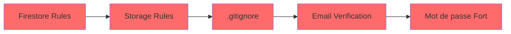
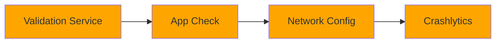

# 🛡️ Sécurisation des Applications - Guide Rapide

## 📚 Documentation Créée

| Fichier | Description | Quand l'utiliser |
|---------|-------------|------------------|
| **GUIDE_SECURITE_COMPLET.md** | Guide technique complet (10 sections) | Pour comprendre en profondeur |
| **SECURITE_ACTIONS_IMMEDIATES.md** | Actions prioritaires avec code prêt à copier | Pour implémenter rapidement |
| **README_SECURITE.md** (ce fichier) | Vue d'ensemble et résumé | Pour orientation générale |

---

## 🎯 Résumé Exécutif

### État Actuel ✅

**Points Forts** :
- ✅ Authentification Firebase en place
- ✅ Firestore Security Rules existantes (bonnes bases)
- ✅ Rôles admin protégés (`allow write: if false`)
- ✅ Validation propriétaire pour posts/comments
- ✅ Secrets dans `.env` files

**Points à Améliorer** :
- ⚠️ Règles Firestore incomplètes (conversations manquantes)
- ⚠️ Pas de Firebase Storage Rules
- ⚠️ Pas de vérification email obligatoire
- ⚠️ Validation mot de passe faible (6 caractères minimum)
- ⚠️ Pas de rate limiting
- ⚠️ Pas de Firebase App Check
- ⚠️ Pas de Crashlytics
- ⚠️ Obfuscation non configurée

---

## 🚀 Plan d'Action Recommandé

### Phase 1 : CRITIQUE (Aujourd'hui - 2 heures)



1. **Mettre à jour Firestore Rules** (15 min)
   - Ajouter règles pour `conversations`
   - Ajouter règles pour `sent_messages_history`
   - Déployer : `firebase deploy --only firestore:rules`

2. **Créer Storage Rules** (10 min)
   - Créer `storage.rules`
   - Bloquer tout (vous utilisez Cloudinary)
   - Déployer : `firebase deploy --only storage`

3. **Vérifier `.gitignore`** (5 min)
   - Vérifier que `.env` files sont exclus
   - Vérifier que `google-services.json` sont exclus
   - Scanner avec `git log` pour secrets accidentels

4. **Email Verification** (30 min)
   - Modifier `auth_screen.dart` → `_signUp()`
   - Envoyer email de vérification
   - Bloquer connexion si non vérifié

5. **Validation Mot de Passe** (30 min)
   - Ajouter fonction `_validatePassword()`
   - Exiger : 8 caractères, 1 maj, 1 chiffre, 1 spécial
   - Mettre à jour UI

**Impact** : 🔒 Sécurité de base garantie

---

### Phase 2 : IMPORTANT (Cette semaine - 4 heures)



1. **Service de Validation** (1h)
   - Créer `validation_service.dart`
   - Sanitize inputs
   - Détecter contenu suspect

2. **Firebase App Check** (1h)
   - Activer dans Console
   - Ajouter package
   - Configurer dans `main.dart`

3. **Network Security Config** (30 min)
   - Android seulement
   - Bloquer HTTP non sécurisé
   - Whitelist domaines

4. **Crashlytics** (30 min)
   - Activer dans Console
   - Ajouter package
   - Configurer handlers

**Impact** : 🛡️ Protection contre attaques courantes

---

### Phase 3 : RECOMMANDÉ (Ce mois - 8 heures)


1. **Rate Limiting** (2h)
   - Service de limitation
   - Appliquer sur login/posts
   - Logger tentatives

2. **Obfuscation** (2h)
   - Configurer ProGuard (Android)
   - Configurer Strip (iOS)
   - Tester build release

3. **Logs de Sécurité** (2h)
   - Service de logging
   - Logger événements critiques
   - Analyser dans Firestore

4. **Tests de Sécurité** (2h)
   - Tester sur appareil réel
   - Tester attaques courantes
   - Audit manuel

**Impact** : 🏆 Niveau de sécurité production

---

## 📊 Niveau de Sécurité

### Avant (État Actuel)
```
🔴 FAIBLE : 3/10
├─ ✅ Authentification basique
├─ ✅ Rules Firestore partielles
└─ ❌ 8 vulnérabilités majeures
```

### Après Phase 1
```
🟡 MOYEN : 6/10
├─ ✅ Rules complètes
├─ ✅ Email vérifié
├─ ✅ Mots de passe forts
└─ ⚠️ Manque protection avancée
```

### Après Phase 2
```
🟢 BON : 8/10
├─ ✅ App Check activé
├─ ✅ Validation inputs
├─ ✅ Monitoring erreurs
└─ ⚠️ Optimisations restantes
```

### Après Phase 3
```
🟢 EXCELLENT : 9.5/10
├─ ✅ Rate limiting
├─ ✅ Code obfusqué
├─ ✅ Logs sécurité
└─ ✅ Prêt production
```

---

## 🔥 Top 5 Vulnérabilités à Corriger

| # | Vulnérabilité | Gravité | Temps | Fichier |
|---|---------------|---------|-------|---------|
| 1 | **Conversations non protégées** | 🔴 Critique | 15 min | `firestore.rules` |
| 2 | **Pas de Storage Rules** | 🔴 Critique | 10 min | `storage.rules` |
| 3 | **Email non vérifié** | 🟠 Haute | 30 min | `auth_screen.dart` |
| 4 | **Mot de passe faible** | 🟠 Haute | 30 min | `auth_screen.dart` |
| 5 | **Pas de rate limiting** | 🟡 Moyenne | 2h | `rate_limiter_service.dart` |

---

## 💡 Quick Wins (Impact Maximum, Effort Minimum)

### 1. Firestore Rules (15 min) ⚡
```bash
cd hermin
# Copier code depuis SECURITE_ACTIONS_IMMEDIATES.md
# Ajouter dans firestore.rules
firebase deploy --only firestore:rules
```
**Impact** : Protection conversations + historique admin

### 2. .gitignore (5 min) ⚡
```bash
# Vérifier que secrets sont exclus
cat .gitignore | grep ".env"
cat .gitignore | grep "google-services.json"
```
**Impact** : Secrets protégés

### 3. Email Verification (30 min) ⚡
```dart
// Dans _signUp() après createUser
await user.sendEmailVerification();
await FirebaseAuth.instance.signOut();
```
**Impact** : Comptes vérifiés seulement

### 4. Validation Password (30 min) ⚡
```dart
String? _validatePassword(String? value) {
  if (value == null || value.length < 8) return 'Min 8 caractères';
  if (!RegExp(r'[A-Z]').hasMatch(value)) return '1 majuscule requise';
  if (!RegExp(r'[0-9]').hasMatch(value)) return '1 chiffre requis';
  return null;
}
```
**Impact** : Mots de passe robustes

---

## 📖 Comment Utiliser Cette Documentation

### Si vous avez 1 heure
→ Lire **SECURITE_ACTIONS_IMMEDIATES.md** section "Priorité 1"
→ Appliquer les 5 actions critiques

### Si vous avez une demi-journée
→ Lire **SECURITE_ACTIONS_IMMEDIATES.md** sections "Priorité 1 + 2"
→ Implémenter Phase 1 + Phase 2

### Si vous voulez comprendre en profondeur
→ Lire **GUIDE_SECURITE_COMPLET.md** (10 sections)
→ Implémenter progressivement

### Si vous êtes perdu
→ Commencer par ce fichier (README_SECURITE.md)
→ Suivre le "Plan d'Action Recommandé"

---

## 🛠️ Outils Utiles

### Firebase
```bash
# Déployer rules
firebase deploy --only firestore:rules
firebase deploy --only storage

# Tester rules
firebase emulators:start --only firestore

# Logs
firebase functions:log
```

### Flutter
```bash
# Build sécurisé
flutter build apk --release --obfuscate --split-debug-info=build/debug-info

# Analyser code
flutter analyze

# Tests
flutter test
```

### Git
```bash
# Vérifier secrets
git log --all --full-history -- "**/.env.*"

# Nettoyer historique (DANGER)
git filter-branch --force --index-filter \
  "git rm --cached --ignore-unmatch path/to/secret" \
  --prune-empty -- --all
```

---

## 📞 Support & Questions

### Documentation
- **GUIDE_SECURITE_COMPLET.md** : Explication détaillée de chaque point
- **SECURITE_ACTIONS_IMMEDIATES.md** : Code prêt à l'emploi
- **Firebase Docs** : https://firebase.google.com/docs/rules
- **Flutter Security** : https://flutter.dev/docs/deployment/security

### Checklist Avant Production
- [ ] Firestore Rules complètes et testées
- [ ] Storage Rules déployées
- [ ] Email verification activée
- [ ] Mots de passe forts requis
- [ ] App Check activé
- [ ] Crashlytics configuré
- [ ] Code obfusqué
- [ ] Secrets hors du repo
- [ ] Build release testé sur appareil réel
- [ ] Politique de confidentialité ajoutée

---

## 🎯 Prochaine Étape

**👉 Commencez par** `SECURITE_ACTIONS_IMMEDIATES.md` **section "À Faire MAINTENANT"**

Prenez 2 heures aujourd'hui pour sécuriser les bases critiques. Votre application sera 3x plus sécurisée !

**Bon courage champion ! 🛡️🚀**

---

**Dernière mise à jour** : 29 Décembre 2025  
**Version** : 1.0  
**Auteur** : Assistant de Sécurité

